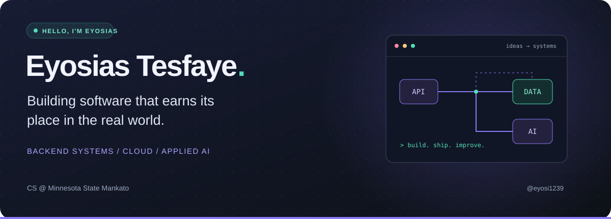
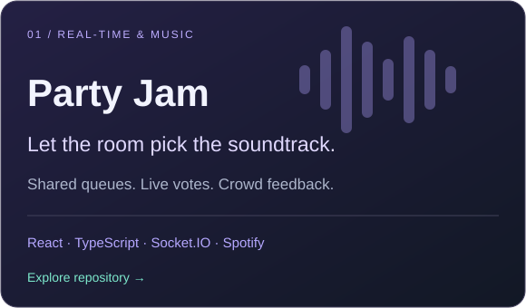
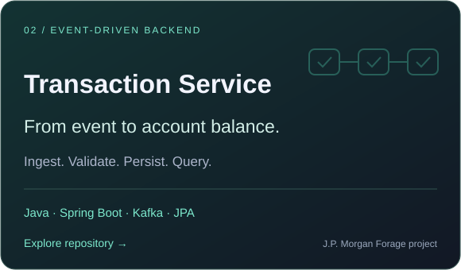

  

  
  
  

### A little about me

I'm Eyosias, a computer science student who likes turning messy workflows into software people actually use. I've built tools for hotel front desks, nursing classrooms, and cloud deployments. I'm especially interested in backend engineering, distributed systems, and putting AI to practical use.

🎓 **Minnesota State University, Mankato** · B.S. Computer Science · Mathematics minor · December 2027

- **Building now:** Party Jam, where the crowd helps decide what plays next.
- **Working on:** data integrations and reporting automation for the Maverick Family Nursing Simulation Center.
- **In the community:** GDG president at MSU, ColorStack board member, and NSBE member.

### Things I've shipped

| Where | What I worked on | Impact |
| :--- | :--- | :--- |
| **Capital One** · SWE Intern | Git-driven configuration delivery for a shared Keycloak platform, AWS infrastructure, and local testing | Eliminated ~180 manual production deploys/year; reduced failed builds by ~70% |
| **SAFEHR** · Client Project | 15+ Django REST endpoints for patient charting, sharing, and assignments, with access control across four roles | Supported a pilot for ~200 student nurses; reached 80% test coverage |
| **DeskMate** · Hotel Co-op | An LLM front desk assistant with Cloudbeds reservation and payment integrations | Adopted into production; reduced failed check-ins by 15+/month |

### On my workbench

**Party Jam** brings queue order, votes, and presence together in real time. I'm building a Python recommender that uses live crowd feedback and the host's selected mode to help choose the next song.

**Transaction Processing Service** is my J.P. Morgan Forage project: a Spring Boot microservice that consumes Kafka transactions, validates and persists them with JPA/H2, and exposes a balance-query API.

### Tools I reach for

**Languages**

**Applications &amp; data**

**Cloud &amp; infrastructure**

---

  <b>Have something useful, ambitious, or a little unusual in mind?</b> 
  I'm open to collaborating on backend systems, automation, and applied AI.  
  <a href="mailto:eyosias.tesfaye@mnsu.edu">Let's build it.</a>

